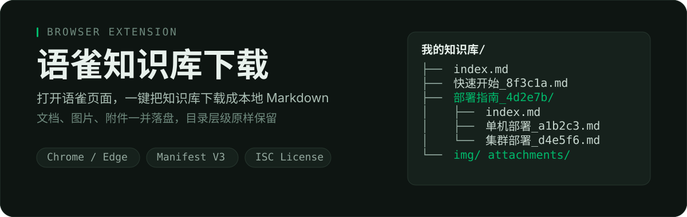
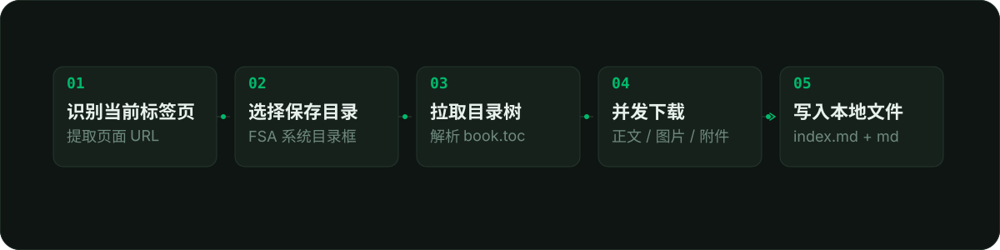
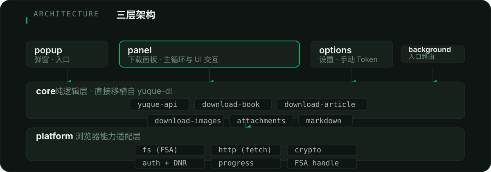

<p align="center">
  
</p>

<div align="center">

[](./LICENSE)
[](./manifest.json)
[](#安装)

**English:** One-click download of the currently open Yuque knowledge base / document as local Markdown, with images and attachments preserved.

</div>

---

## 一句话

打开语雀页面，点一下插件，**把整个知识库或单篇文档下载成本地 Markdown**——文档正文、图片、附件按原层级落盘，并自动生成 `index.md` 目录。

> 本项目基于 [gxr404/yuque-dl](https://github.com/gxr404/yuque-dl)（ISC License）的核心逻辑改造，把 Node 专属能力（`fs`、`axios`、`node:crypto`）全部替换为浏览器原生 API，做成 Chrome / Edge MV3 扩展。

---

## 效果：下载后长什么样

```text
我的知识库/
├── index.md
├── 快速开始_8f3c1a.md
├── 部署指南_4d2e7b/
│   ├── index.md
│   ├── 单机部署_a1b2c3.md
│   └── 集群部署_d4e5f6.md
├── 常见问题_9c8d7e.md
├── img/
│   └── 8f3c1a/
└── attachments/
    └── 9c8d7e/
```

- 每篇文档生成 `{标题}_{uuid}.md`；若该标题下还有子文档，则生成 `{标题}_{uuid}/index.md`。
- 图片放到对应文档附近的 `img/{uuid}/`，Markdown 里的链接自动改写成相对路径。
- 附件放到 `attachments/{uuid}/`。
- 知识库根目录会再生成一份 `index.md`，方便快速浏览整库结构。

<p align="center">
  
</p>

---

## 为什么是浏览器插件

| 痛点（CLI 版） | 浏览器插件解法 |
|---|---|
| 要手动找 `_yuque_session` 和 `yuque_ctoken` | 直接复用浏览器已登录的语雀 Cookie |
| 终端里选目录、配路径 | 用 File System Access API 弹出系统目录选择框 |
| 未登录的私有分享库需要粘贴 Cookie | 设置页开启手动 Token，通过 DNR 临时注入请求头 |
| 不知道下载进度 | 面板实时显示 TOC、进度条、失败项与重试按钮 |

---

## 架构

<p align="center">
  
</p>

- **UI 层**：`popup` 负责入口识别，`panel` 承载完整下载交互与主循环，`options` 管理手动 Token，`background` 只做入口路由。
- **core 层**：直接移植自 `yuque-dl` 的纯逻辑——页面/TOC/单文档解析、Markdown 修复、图片签名、目录生成等。
- **platform 层**：把 Node 能力替换为浏览器 API：`fs` → File System Access API，`http` → `fetch` + `credentials: 'include'`，`crypto` → Web Crypto，`auth` → Cookies + DNR，`progress` → IndexedDB 与本地 `progress.json`。

---

## 安装

> 当前未上架 Chrome Web Store，需通过「加载已解压的扩展程序」安装。

```bash
git clone https://github.com/MuziGeek/yuque-dl-extension.git
cd yuque-dl-extension
npm install
npm run build          # 产物在 dist/ 目录
```

1. 打开 Chrome / Edge，地址栏输入 `chrome://extensions`（Edge 为 `edge://extensions`）。
2. 开启右上角「开发者模式」。
3. 点击「加载已解压的扩展程序」，选择本项目的 `dist` 文件夹。
4. 工具栏出现插件图标即安装成功。

---

## 使用

1. 在浏览器中登录语雀，并打开要下载的**知识库首页**（例如 `https://www.yuque.com/用户名/知识库名`）或**文档页**。
2. 点击工具栏插件图标，弹窗会显示当前标签页识别结果，点击「打开下载面板」。
3. 在面板中：
   - 确认目标链接；
   - 点击「选择文件夹…」选择本地保存目录；
   - 按需调整选项（忽略图片、附件、并发数等）；
   - 点击「开始下载」。
4. 下载完成后打开所选目录，即可看到 `{知识库名}/index.md` 与对应文档、图片、附件。

---

## 权限说明

| 权限 | 用途 |
|---|---|
| `tabs` | 读取当前标签页 URL |
| `cookies` | 检测语雀登录态，获取 Cookie 用于 DNR 注入 |
| `storage` | 保存用户设置与下载进度镜像 |
| `declarativeNetRequest` + `WithHostAccess` | 手动 Token 模式下向语雀请求注入 Cookie 头 |
| `contextMenus` | 页面右键菜单「下载此语雀页面」 |
| `host_permissions: https://*.yuque.com/*` | 访问语雀页面与 API（自动携带 Cookie） |
| `optional_host_permissions: https://*/*` | 企业自定义域名（在设置中填写后申请） |

---

## 手动 Token（兜底方案）

如果浏览器未登录语雀，或需要下载别人分享的私有知识库：

1. 在语雀登录后，打开 Chrome 开发者工具 → Application → Cookies → 复制 `_yuque_session` 的值。
2. 打开插件「设置」页面，开启「启用手动 Token」，粘贴 Cookie 值。
3. 重新打开下载面板开始下载。

> 手动 Token 通过 DNR 会话规则临时注入 `Cookie` 头，不会写入浏览器 Cookie 存储，会话结束即失效。

---

## 开发

```bash
npm install          # 建议使用系统 Node / 普通终端，避免当前 shell 占用 node.exe 导致 esbuild postinstall 失败
npm run build        # 构建到 dist/
npm run watch        # 监听构建
npm run typecheck    # TypeScript 类型检查
npm run test         # 基础单元测试
```

---

## 构建与测试状态

- `npm run build`：通过，生成完整 `dist/`。
- `npm run typecheck`：通过，无 TS 错误。
- `npm run test`：全部通过。

---

## 已知限制

- 密码保护的知识库：当前版本建议「先在浏览器打开该库并输入一次密码」，之后插件即可复用 Cookie 下载。
- 视频/音频下载、账号下全部知识库批量导出：暂未实现，可作为后续增强。
- 仅支持 Chromium 内核浏览器（Chrome / Edge），因为依赖 File System Access API 与 declarativeNetRequest。

---

## License

[ISC License](./LICENSE)

核心下载逻辑来自 [gxr404/yuque-dl](https://github.com/gxr404/yuque-dl)，浏览器适配、UI、文件系统、鉴权与进度部分为独立实现。
